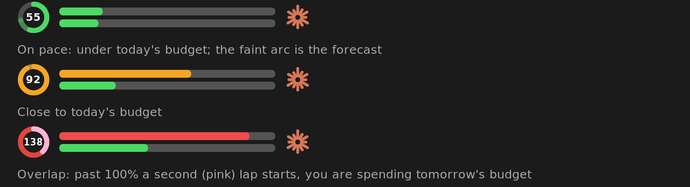
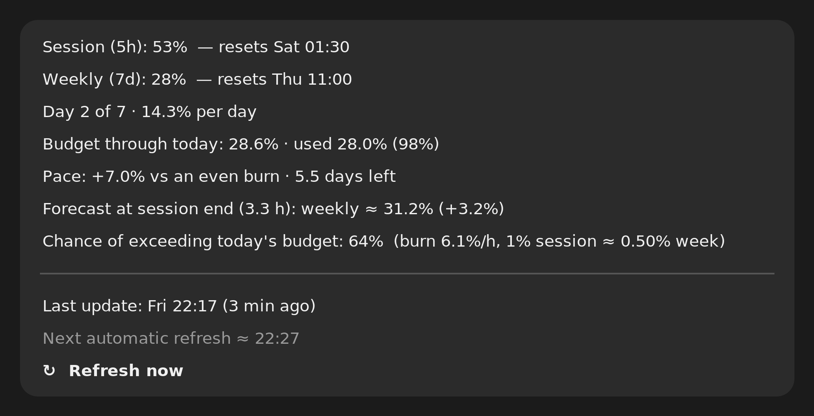

# claude-usage-indicator

Your Claude usage, right next to the clock in the GNOME top bar.


*(Renders generated by `mise run previews` from the same geometry the extension draws.)*

| | |
|---|---|
| **Ring** (left) | Today's **pace**: the week has 7 days, so each day is 14.3 % of the weekly budget. One lap = budget through the end of today. Used less earlier → more room today. |
| **Top bar** | 5-hour **session** usage |
| **Bottom bar** | 7-day **weekly** usage |
| **Claude icon** (right) | Just there to tell you what it is |

Bars go green → amber (60 %) → red (85 %).



The ring is *smart about overlap*: past 100 % a second, pink lap starts on top of a full red one, so you can see when you are spending tomorrow's budget. The faint arc is a **forecast** of where the current session will take it.

## Click it



- exact numbers and reset times,
- **forecast**: expected weekly usage when the 5 h session ends and the probability of exceeding today's budget,
- when the data was **last updated**, when the next automatic refresh is, and a **Refresh now** button.

## Install

Requirements: Ubuntu / GNOME Shell **50** (the version it was built and tested on), [mise](https://mise.jdx.dev), and a logged-in [Claude Code](https://claude.com/claude-code) (it reads `~/.claude/.credentials.json`).

```sh
git clone https://github.com/cristiansteib/claude-usage-indicator
cd claude-usage-indicator
mise trust && mise run install
```

GNOME only discovers newly installed extensions at login, so **log out and back in once**. After that, `mise run reload` applies changes without logging out.

| Task | What it does |
|---|---|
| `mise run install` | build, install daemon to `~/.local/bin`, extension to `~/.local/share/gnome-shell/extensions`, enable autostart |
| `mise run reload` | re-install and hot-reload the extension |
| `mise run status` | print cached usage / ring / forecast (no network) |
| `mise run test` | `go vet` + unit tests |
| `mise run previews` | regenerate the images above (needs ImageMagick) |
| `mise run hooks` | enable the commit-message policy hook |
| `mise run release:dry` | preview the next semantic-release |
| `mise run uninstall` | remove everything |

## How it works

```
 Go daemon ──(HTTPS, cached, rate-limited)──▶ Claude usage API
     │ writes $XDG_RUNTIME_DIR/claude-usage.json
     ▼
 GNOME Shell extension (draws ring + bars + icon, reads the file, Refresh via D-Bus)
```

- **Gentle on the API.** Result cached in `~/.cache/claude-usage-indicator/state.json`; one automatic request per 10 min; 2 min cooldown on manual refresh; exponential backoff (5 → 60 min, persisted) after errors such as HTTP 429. A restart or login never fires a request while the cache is fresh.
- **Light at login.** Autostart is delayed 20 s, the extension reads its file asynchronously at low priority, the daemon idles at ~10 MB and ~0 % CPU.
- **Forecast** (probabilistic): the extra session-% still to be burnt is modelled as a normal variable from this session's measured burn rate and its variance; it is converted to weekly-% with a ratio learned from samples, and the chance of ending above today's budget is read off the distribution. It needs a little usage data before it shows numbers.

## Contributing & releases

Releases are automated with [semantic-release](https://semantic-release.gitbook.io) and are intentionally **boring**: almost every change is a `fix:` (patch). Minor/major releases are reserved for **contract** changes (the published JSON, the D-Bus API, CLI flags, install layout) via `feat(contract):` / `<type>(contract)!:`. A plain `feat:` is rejected.

```sh
mise run hooks        # enable the commit-msg check in your clone
mise run release:dry  # preview the next release
```

Details for humans and AI agents are in [AGENTS.md](AGENTS.md).

## Caveats

- It uses the **undocumented** `https://api.anthropic.com/api/oauth/usage` endpoint that Claude Code itself uses. It may change or be rate-limited without notice; the app degrades to cached data.
- Your OAuth token is read from `~/.claude/.credentials.json`, sent only to `api.anthropic.com`, and never stored elsewhere.
- Not affiliated with Anthropic.

## License

[MIT](LICENSE)
